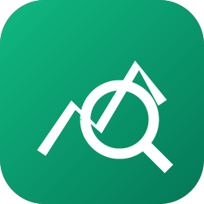

<!-- Modificado por Grupo MOST para Most Anything. Obra original: Craft Anything del equipo ArtCraft (https://github.com/storytold/craft-anything), Apache-2.0. -->

<p align="center">
  
</p>

<h1 align="center">Most Anything</h1>

<p align="center">
  <a href="README.md">English</a> · <b>日本語</b> · <a href="README.zh.md">简体中文</a> · <a href="README.ko.md">한국어</a>
</p>

<p align="center">
  <b>あらゆる Web サイト、アプリ、ゲームがどう動いているかを見て、あなた自身の版を AI に作らせる。純粋な Rust で書かれた、オープンソースのクリーンルームエンジン。</b><br>
  対象を指定して、欲しいものを伝えるだけ。実際の調査ツールで元のソフトを調べ、<br>
  コーディングエージェントに新しいプロジェクトを作らせ、結果を元のソフトと比較して磨き上げます。
</p>

<p align="center">
  
  
  
  
</p>


<br>

<p align="center">
  
  <br>
  <sub>Web サイトプロジェクト: 各チェックは、ビルドが元のソフトにどれくらい似ているかを示し、ルールから外れるものはあなたが承認し、プランは残りの作業を示します。</sub>
</p>

> [!NOTE]


<br>

<table>
  <tr>
    <td width="25%" valign="top">
      <h3>🔍 なんでも調べる</h3>
      Web サイト、デスクトップアプリ、スマホアプリ、ゲーム、ファイル。本物の調査ツールが、それらがどう作られ、何をするのかを突き止め、答えの裏付けとなるエビデンスも添えます。
    </td>
    <td width="25%" valign="top">
      <h3>🛠️ 自分の版を作る</h3>
      「この Web サイトを再現して」「このゲームのゲームプレイを Rust で再現して」と伝えれば、コーディングエージェントが指定した技術スタックで新しいプロジェクトを作ります。
    </td>
    <td width="25%" valign="top">
      <h3>✅ 推測ではなく検証</h3>
      すべてのビルドは元のソフトと比較され (3 つの画面幅で表示したページ、ゲーム自身のセルフテスト、アプリの実行結果)、十分近づくまで磨かれます。
    </td>
    <td width="25%" valign="top">
      <h3>🤖 エージェント対応</h3>
      314 個のツールは、それぞれが CLI コマンドであり、MCP ツールでもあります。どのエージェントでも、アプリが使うのと同じエンジンを動かせます。調査に AI は要りません。
    </td>
  </tr>
</table>

<br>

<a name="how-it-works"></a>

## 仕組み

Most Anything で対象を指定し、欲しいものを伝えて「Start」を押すだけ。4 つのステップで進み、判断が必要なときは、わかりやすい言葉であなたに尋ねます:

1. **調べる (Study):** 元のソフトを調査します。あらゆる幅で表示したページ、コード、ファイル、動作のしかたを調べます。
2. **作る (Build):** コーディングエージェントが新しいプロジェクトを作ります。言語、フレームワーク、エンジンはリクエストで指定したもの (指定がなければ妥当な既定値)を使います。
3. **確認する (Check):** ビルドを元のソフトと比較し、まだ一致していない点を一覧にします。
4. **完成 (Ready):** 結果を開いたり、遊んだり、プレビューしたりできます。変更を頼めば磨き直します。

<table>
  <tr>
    <td width="50%" valign="top">
      <br>
      <sub><b>Make:</b> 何を再現するかを選び、欲しいものを伝え、Start を押します。</sub>
    </td>
    <td width="50%" valign="top">
      <br>
      <sub><b>Ready:</b> ゲームで遊ぶ。変更は下の欄から頼めます。</sub>
    </td>
  </tr>
</table>

<a name="two-ways-to-use-it"></a>

## 2 つの使い方

- **Simple** (既定): 「What do you want to make?」と表示されるので、Web サイト、アプリ、ゲームから選び、説明して Start を押します。プロジェクトページには 4 つのステップ (Study → Build → Check → Ready)、エージェントが今何をしているかの平易な説明、質問と承認のカード、結果がどれくらい似ているか、結果やそのフォルダを開くボタンが並びます。変更は下の入力欄から頼めます。「Just look inside」は、何も作らずに対象へ質問できます (ディープモード時)。
- **Advanced**: フル機能のワークベンチ。すべてのツール (Ctrl/Cmd+K)、関数、文字列、疑似 C、逆アセンブル、16 進数、コールグラフ、エビデンス、不明点、ジョブ、ログ、エージェントコンソール。

どちらのモードも同じエンジンを動かします。

## クリーンルーム(Clean room)かディープモード(Deep)

- **クリーンルーム(Clean room)** (既定): 元のソフトの中身は一切読みません。コードも、ファイルも、ページのソースも読みません。Most Anything は、あなたに見えるものだけから作業します。追加した画像、訪問者から見た Web サイト (スクリーンショット、見えているテキスト、計測したレイアウト、色、フォント、余白、開いたメニュー)、そして許可した場合はアプリのウィンドウの画像です。中を覗こうとするツールは拒否され、ディープモードの有効化方法を案内します。
- **ディープモード(Deep)**: すべてのツールを使います。私的利用のためのモードです。プログラムのコードとファイルは内蔵エンジン (インストールされていれば Ghidra も)で読み、Web サイトの JavaScript を読み、そのスタートページを観察します。ビルダーもそれらすべてを使えます。

タイトルバーまたは Settings で切り替えられます。`settings_set deep_mode true` で設定するか、CLI の 1 回限りなら `--deep` (または `--clean-room`)を使ってください。

<p align="center">
  
  <br>
  <sub><b>Advanced:</b> 関数、疑似 C、エージェント、そしてあらゆる答えの裏にあるエビデンス。</sub>
</p>

<a name="ai"></a>

## AI

ビルドには、お使いのコンピュータ上のコーディングエージェントが必要です。まず **Claude Code** に対応しています。Most Anything は、あなた自身の改変されていない `claude` プログラムを実行します。これはあなた自身のサインイン情報を使います。Most Anything がアカウントを見たり扱ったりすることはありません。利用は Anthropic とのあなた自身の契約に従います。方法と理由は [docs/claude-code.md](docs/claude-code.md) を参照してください。Codex アダプターもありますが、実際のインストール環境ではまだ検証されていません。質問と分析には、Anthropic、OpenAI、OpenRouter、ローカルの OpenAI 互換サーバーが使えます (Settings → AI)。

<a name="built-for-agents"></a>

## エージェント向け

すべてのツールは CLI サブコマンドでも MCP ツールでもあるので、エージェントはアプリなしで対象を調べたり、再構築を丸ごと実行したりできます:

```sh
craft-anything-cli commands                                   # every tool, by toolset
craft-anything-cli mcp                                        # serve them to any MCP client
craft-anything-cli rebuild https://example.com "Recreate this website"
```

結果は、信頼度・カバレッジ・制限事項を備えたエビデンス記録です。大きな結果はまず要約として返り、`core_evidence_browse` でページ送りできます。`craft-anything-cli setup` は Most Anything をコーディングエージェントのアプリにつなぎます。

<a name="under-the-hood"></a>

## 内部の仕組み

純粋な Rust で書かれたリバースエンジニアリングエンジンです。ネイティブプログラム、.NET、Java、Android、Apple、Electron/JavaScript、Web サイト、ファームウェア、パケットキャプチャ、データベース、ゲームファイル向けに 314 個のツール (うち 298 個がエンジン本体、残りは AI とセットアップの層)を備えています。独自のデコーダ、逆アセンブラ、逆コンパイラは外部プログラムなしで動きます。ディープモードではそれらすべてを使い、インストールされていれば Ghidra も使います。これがデスクトップアプリ (egui)、CLI、MCP サーバーを支え、一部は WebAssembly としてブラウザでも動きます。全リストは [docs/tools.md](docs/tools.md) にあります。

<a name="get-started"></a>

## はじめかた

Rust **1.97 以降**が必要です (依存関係が要求します。`rustup update`)。Debian か Ubuntu では、デスクトップアプリには次のものも必要です:

```sh
sudo apt-get install libxkbcommon-dev libwayland-dev libx11-dev libxrandr-dev libxi-dev libgl1-mesa-dev libgtk-3-dev
```

続いて:

```sh
git clone https://github.com/mapachstudio/most-anything && cd craft-anything
cargo run --release -p craft-anything                # the desktop app
cargo install --path apps/craft-anything-cli         # the CLI, as `craft-anything-cli`
craft-anything-cli doctor                            # checks the install, coding agents and engines
```

ビルドには、コンピュータ上でサインイン済みのコーディングエージェントが必要です ([AI](#ai) を参照)。足りないものは `doctor` が示します。コマンドラインからの再構築 (ターミナルで質問に答えます):

```sh
craft-anything-cli rebuild https://example.com "Recreate this website"
craft-anything-cli rebuild - "A snake game in Rust" --rounds 1
craft-anything-cli rebuild https://example.com "Make the header blue" --continue-in "<project folder>"
craft-anything-cli rebuild - "Add a contact form" --project-folder "<your folder>" --existing edit
```

新しいプロジェクトは `Documents/Most Anything` に作られます (Settings → General で変更できます)。各プロジェクトフォルダには `craft.json` (リクエスト、対象、状態、履歴)、`capture/` (対象から記録したもの)、`app/` (生成されたプロジェクト)、`checks/` (元のソフトとの比較ごとの結果)、`investigation.cany/` (エビデンス)、`inbox/` (未回答の質問)が入ります。

プロジェクトは、選んだフォルダから始めることもできます (Start の下にある「Choose a folder…」、または `--project-folder`)。すでにファイルがある場合は、それが何なのかを答えます。アプリ本体 (ビルダーがその場で編集します)か、そこから始める素材 (アプリはその隣の `app/` に作られます)のどちらかです (Settings → General で答えを記憶できます)。Settings → General では、ほかのフォルダにあるプロジェクトも一覧できます。一覧から外すと、その一覧から消えるだけです。

<a name="status"></a>

## ステータス

> [!IMPORTANT]
> **ステータス:** Most Anything はアルファ版の初期段階です。いま動くもの、一部だけのもの、この先の予定:
>
> - **いま動くもの:** デスクトップアプリ (Simple と Advanced)、CLI、MCP サーバー。Claude Code
> をビルダーとして、Web サイト・アプリ・ゲームを「調べる → 作る → 確認する → 磨く」の順に進める
> ワークフロー。3 つの画面幅での Web サイト確認。Unity、Unreal、Godot でのゲーム再構築。Ghidra を
> 使うディープモード。生成画像と 3D モデル (オプトイン、自分の fal.ai キー)。プラグイン (MCP
> サーバー、および `wasm-plugins` オプション付きビルドでの WASM コンポーネント)。
> - **一部だけ:** API キーや他のコーディングエージェントでのビルド (実装済み、実環境では未実行)、
> アプリとゲームの挙動チェック、実物ではなくダミーの対象でしかテストしていない一部のエンジンツール。
> - **次:** 最初の公開リリース (Windows、macOS、Linux、FreeBSD 向けインストーラとブラウザ
> ビューアは CI に用意済み)、その後マネージドプランを提供予定。
>
> [docs/STATUS.md](docs/STATUS.md) に詳細と、各部分をどう確かめたか、
> [docs/tool-status.md](docs/tool-status.md) にツールごとのチェックリスト、
> [docs/ROADMAP.md](docs/ROADMAP.md) に計画の項目別一覧があります。issue を立てるか、

**責任ある使い方。** Most Anything は、所有しているか、調べる許可があるソフトにだけ使ってください。DRM、ログイン、
アンチチートを回避することは決してありません。再構築は、エビデンスに基づいてレイアウト・スタイル・挙動を再現します。エージェントには、ロゴ・写真・テキストを、あなたが権利を持つか使用許可があると確認できるまでコピーしないよう指示しています。

<a name="downloads"></a>

## ダウンロード

GitHub の [最新リリース](https://github.com/mapachstudio/most-anything/releases/latest) には以下に挙げるすべてのビルドがあり、[すべてのリリース](https://github.com/mapachstudio/most-anything/releases) には過去のバージョンとそのリリースノートがあります。ファイル名の `<ver>` はバージョン番号で、`SHA256SUMS.txt` に各ファイルのチェックサムが載っています。

### Windows

| ビルド | インストーラ | ポータブル |
|---|---|---|
| x64 (64 ビット Intel/AMD) | `craft-anything-<ver>-windows-x64.msi` | `craft-anything-<ver>-windows-x64-portable.zip` |
| arm64 (Snapdragon などの ARM PC) | `craft-anything-<ver>-windows-arm64.msi` | `craft-anything-<ver>-windows-arm64-portable.zip` |
| x86 (32 ビット) | `craft-anything-<ver>-windows-x86.msi` | `craft-anything-<ver>-windows-x86-portable.zip` |

インストーラと実行ファイルはコード署名済みです。ポータブルの zip は設定をアプリの隣に保存します。

### macOS

| ビルド | ファイル | 備考 |
|---|---|---|
| アプリ、ユニバーサル (Apple silicon + Intel) | `craft-anything-<ver>-macos-universal.dmg` | 署名・公証済み |
| コマンドラインツール、ユニバーサル | `craft-anything-cli-<ver>-macos-universal.zip` | 署名・公証済み。macOS がブロックする場合は下記を参照 |

0.2.0 以降のバージョンではコマンドラインツールがアプリに同梱されるため、ビルドに別の zip は
不要です。必要なのは、アプリなしでコマンドラインだけを使う場合です。

ブラウザから zip をダウンロードすると「Apple could not verify craft-anything-cli」で止まることが
あります(単体のプログラムは公証を自分に添付できないため、macOS がオンラインで確認します)。
ターミナルからのダウンロードはこの検査を受けないので、代わりに次を使ってください:

```sh
ver=0.2.0   # change this to the version you want
curl -fLO "https://github.com/mapachstudio/most-anything/releases/download/v$ver/craft-anything-cli-$ver-macos-universal.zip"
ditto -x -k "craft-anything-cli-$ver-macos-universal.zip" .
mkdir -p ~/.local/bin
mv "craft-anything-cli-$ver-macos-universal/craft-anything-cli" ~/.local/bin/
~/.local/bin/craft-anything-cli --version
```

`craft-anything-cli` だけで実行したい場合は、`~/.local/bin` を `PATH` に追加してください。

すでにブロックされたコピーがある場合は、Done(「ゴミ箱に入れる」ではなく)を押してから
`xattr -d com.apple.quarantine <craft-anything-cli のパス>` を実行するか、システム設定 →
プライバシーとセキュリティ → このまま開く で許可してください。

### Linux

| 形式 | x86_64 | aarch64 (ARM64) | 備考 |
|---|---|---|---|
| AppImage | `craft-anything-<ver>-linux-x86_64.AppImage` | `craft-anything-<ver>-linux-aarch64.AppImage` | どこでも動きます。[AppImageUpdate](https://github.com/AppImageCommunity/AppImageUpdate) で自己更新します (`.zsync` ファイル) |
| Flatpak | `craft-anything-<ver>-linux-x86_64.flatpak` | `craft-anything-<ver>-linux-aarch64.flatpak` | サンドボックス化。`flatpak install --user <file>` |
| Debian/Ubuntu | `craft-anything-<ver>-linux-x86_64.deb` | `craft-anything-<ver>-linux-aarch64.deb` | |
| Fedora/RHEL/openSUSE | `craft-anything-<ver>-linux-x86_64.rpm` | `craft-anything-<ver>-linux-aarch64.rpm` | |
| Tarball | `craft-anything-<ver>-linux-x86_64.tar.gz` | `craft-anything-<ver>-linux-aarch64.tar.gz` | どこにでも展開できます |

RISC-V (riscv64): `craft-anything-<ver>-linux-riscv64.tar.gz`、tarball のみです。

### FreeBSD

| ビルド | ファイル |
|---|---|
| x86_64 | `craft-anything-<ver>-freebsd-x86_64.tar.gz` |

### Web (WebAssembly)

| ビルド | ファイル | 備考 |
|---|---|---|
| ブラウザビューア | `craft-anything-web-<ver>.zip` | ファイルが何であるかをブラウザ上で示します (ファイルはブラウザから出ません)。フォルダはどんな静的 Web サーバーでも公開できます ([packaging/web/README.md](packaging/web/README.md)) |

<br>


<h3 align="center">一緒にものづくりを</h3>

<p align="center">
  私たちの Discord は、あらゆる種類の作り手が集まる場所です。絵を描く人、写真を撮る人、
  デッサンする人、映像を編集する人、文字を組む人、そしてまだ自分が何を作りたいのか
  模索している人。いま取り組んでいることを共有したり、助けを求めたり、不具合を
  教えたり、これらのツールでこうだったらいいのにと思うことを話したりしてください。
  どんな表現手段を使っていても、経験の長さにかかわらず、ここでは誰でも歓迎します。
</p>


---

## ライセンスとクレジット

Craft Anything は [MIT](LICENSE-MIT) または [Apache-2.0](LICENSE-APACHE) のデュアルライセンスです (どちらかお選びください)。Copyright (c) 2026 ArtCraft Team and the Craft Anything contributors; modificaciones Copyright (c) 2026 Grupo MOST. 必要な通知は [NOTICE](NOTICE) にあります。

同梱のフォント、アイコン、画像、その他のアセットは、それぞれ独自のオープンライセンスが適用されます。各アセットの作者、出典、ライセンスは [ATTRIBUTION.md](ATTRIBUTION.md) に記載しています。

スクリーンショットに写っているのは、そのために作られたサンプルプロジェクトです: example.com、スネークゲーム、小さな電卓プログラム。

ArtCraft の名称、ワードマーク、ロゴは ArtCraft Team の商標であり、当社のものではありません。そのブランドライセンスの要求どおり、本リポジトリからは削除済みです。Most Anything の名称とアイコンは Grupo MOST に帰属します。


---

<sub>このページは [README.md](README.md) の日本語訳です。内容に食い違いがある場合は英語版が優先されます。</sub>
