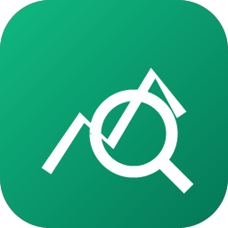

<!-- Modificado por Grupo MOST para Most Anything. Obra original: Craft Anything del equipo ArtCraft (https://github.com/storytold/craft-anything), Apache-2.0. -->
<!-- 本文件是 README.md 的简体中文翻译；英文版有改动时请一并更新本文件。 -->


<p align="center">
  
</p>

<h1 align="center">Most Anything</h1>

<p align="center">
  <a href="README.md">English</a> · <a href="README.ja.md">日本語</a> · <b>简体中文</b> · <a href="README.ko.md">한국어</a>
</p>

<p align="center">
  <b>看清任意网站、应用或游戏是怎么做的，再让 AI 给你造一个自己的版本；一个纯 Rust 写的开源净室引擎。</b><br>
  把目标指给它，说清你想要什么，它就用真实的检查工具研究原作，<br>
  让编码 agent 建一个新项目，把结果与原件比对，再反复收敛。
</p>

<p align="center">
  
  
  
  
</p>


<br>

<p align="center">
  
  <br>
  <sub>一个网站项目：每项检查都说明构建成果有多像，规则之外的任何动作都要你批准，计划显示还剩什么没做。</sub>
</p>

> [!NOTE]


<br>

<table>
  <tr>
    <td width="25%" valign="top">
      <h3>🔍 研究一切</h3>
      网站、桌面程序、手机应用、游戏和文件：真实的检查工具弄清它们是怎么搭起来的、做了什么，每个结论都带着证据。
    </td>
    <td width="25%" valign="top">
      <h3>🛠️ 造一个自己的</h3>
      说出你要什么（“复刻这个网站”、“用 Rust 复刻这个游戏的玩法”），编码 agent 就按你指定的技术栈建一个新项目。
    </td>
    <td width="25%" valign="top">
      <h3>✅ 比对过，不是猜的</h3>
      每个构建都会与原件比对（网页按三种屏宽、游戏跑它自己的自检、应用看它的运行），并反复收敛到足够接近。
    </td>
    <td width="25%" valign="top">
      <h3>🤖 为 agent 准备好</h3>
      314 个工具，每个既是 CLI 子命令、又是 MCP 工具，任何 agent 都能驱动跟应用同一个引擎。纯研究不需要 AI。
    </td>
  </tr>
</table>

<br>

<a id="how-it-works"></a>

## 工作原理

把 Most Anything 指向一个目标，说清你要什么，按下 Start。它分四步走，遇到该你拍板的地方就用大白话问你：

1. **研究：** 检查原件：它在各种宽度下的页面、它的代码、它的文件、它怎么运行。
2. **构建：** 编码 agent 建一个新项目，用你的请求指定的语言、框架或引擎（没指定就用合理默认）。
3. **检查：** 把构建成果与原件比对，列出还不一致的地方。
4. **就绪：** 打开、试玩或预览结果，或者继续提要求让它接着收敛。

<table>
  <tr>
    <td width="50%" valign="top">
      <br>
      <sub><b>Make：</b>选择要复刻什么，说出你要什么，按下 Start。</sub>
    </td>
    <td width="50%" valign="top">
      <br>
      <sub><b>就绪：</b>试玩游戏，或者在下面提改动要求。</sub>
    </td>
  </tr>
</table>

<a id="two-ways-to-use-it"></a>

## 两种用法

- **简单模式**（默认）：“你想做什么？” 选一个网站、应用或游戏，描述它，按下 Start。项目页显示四个步骤（研究 → 构建 → 检查 → 就绪）、agent 正在做什么（用大白话）、提问卡和审批卡、结果有多像，以及打开结果或它所在文件夹的按钮。在底部的输入框里提改动要求。“只看里面”会打开一个目标供你提问，但不构建任何东西（需深度模式）。
- **进阶模式**：完整的工作台：所有工具（Ctrl/Cmd+K）、函数、字符串、伪 C、反汇编、十六进制、调用图、证据、未知项、任务、日志和 agent 控制台。

两种模式驱动同一个引擎。

<a id="clean-room-or-deep"></a>

## 净室还是深度

- **净室**（默认）：绝不读取原件内部的任何东西——不读它的代码、文件或页面源码。Most Anything 只依据你所能看到的来工作：你添加的图片、网站以访客身份呈现的样子（截图、可见文本、测量出的布局、颜色、字体与间距、展开的菜单），以及在你允许时截取的应用窗口画面。所有会往内部看的工具都会被拒绝，并告诉你如何开启深度模式。
- **深度**：使用全部工具，供你自己私下使用。程序的代码和文件由内置引擎读取（装了 Ghidra 时也会用它），网站的 JavaScript 会被读取、起始页面会被持续观察，构建方也可以使用全部这些能力。

在标题栏或设置里切换，或执行 `settings_set deep_mode true`，或单次 CLI 运行时加 `--deep`（或 `--clean-room`）。

<p align="center">
  
  <br>
  <sub><b>进阶：</b>函数、伪 C、agent，以及每个答案背后的证据。</sub>
</p>

<a id="ai"></a>

## AI

构建需要你电脑上有一个已登录的编码 agent。**Claude Code** 是首选支持对象：Most Anything 运行你自己那份未经改动的 `claude` 程序，它用你自己的登录；Most Anything 从不查看也不接触你的账号，你对它的使用适用你与 Anthropic 自己的协议。原因与做法见 [docs/claude-code.md](docs/claude-code.md)。Codex 适配器已存在，但还没在真实安装上验证过。提问和分析可选用 Anthropic、OpenAI、OpenRouter 以及本地 OpenAI 兼容服务（设置 → AI）。

<a id="built-for-agents"></a>

## 面向 agent

每个工具同时是一个 CLI 子命令和一个 MCP 工具，所以 agent 不用打开应用也能研究目标或跑完整个重建：

```sh
craft-anything-cli commands                                   # every tool, by toolset
craft-anything-cli mcp                                        # serve them to any MCP client
craft-anything-cli rebuild https://example.com "Recreate this website"
```

结果是带置信度、覆盖范围和局限性的证据记录；大结果先给摘要，再用 `core_evidence_browse` 分页读取。`craft-anything-cli setup` 把 Most Anything 接到编码 agent 应用上。

<a id="under-the-hood"></a>

## 内部实现

一个纯 Rust 的逆向工程引擎，314 个工具（引擎里 298 个，其余来自 AI 与设置层），覆盖原生程序、.NET、Java、Android、Apple、Electron/JavaScript、网站、固件、抓包、数据库和游戏文件。它自带的解码器、反汇编器和反编译器无需任何外部程序即可工作；深度模式会全部用上，装了 Ghidra 时也会使用它。它支撑着桌面应用（egui）、CLI 和 MCP 服务器，其中一部分还能以 WebAssembly 跑在浏览器里。完整清单在 [docs/tools.md](docs/tools.md)。

<a id="get-started"></a>

## 开始使用

需要 Rust **1.97 或更新**（有依赖要求它；`rustup update`）。在 Debian 或 Ubuntu 上，桌面应用还需要：

```sh
sudo apt-get install libxkbcommon-dev libwayland-dev libx11-dev libxrandr-dev libxi-dev libgl1-mesa-dev libgtk-3-dev
```

然后：

```sh
git clone https://github.com/mapachstudio/most-anything && cd craft-anything
cargo run --release -p craft-anything                # the desktop app
cargo install --path apps/craft-anything-cli         # the CLI, as `craft-anything-cli`
craft-anything-cli doctor                            # checks the install, coding agents and engines
```

构建需要你电脑上已登录一个编码 agent（见 [AI](#ai)）；`doctor` 会告诉你缺什么。从命令行重建（问题在终端里问）：

```sh
craft-anything-cli rebuild https://example.com "Recreate this website"
craft-anything-cli rebuild - "A snake game in Rust" --rounds 1
craft-anything-cli rebuild https://example.com "Make the header blue" --continue-in "<project folder>"
craft-anything-cli rebuild - "Add a contact form" --project-folder "<your folder>" --existing edit
```

新项目放在 `Documents/Most Anything`（可在设置 → 通用里改）。每个项目文件夹里有 `craft.json`（请求、目标、状态和历史）、`capture/`（从目标录到的内容）、`app/`（生成的项目）、`checks/`（每次与原件比对的结果）、`investigation.cany/`（证据）和 `inbox/`（待回答问题）。

项目也可以从你指定的文件夹开始（Start 下的“选择文件夹…”，或 `--project-folder`）。如果那里已经有文件，你要说明它们是什么：就是应用本身（构建方会就地修改），还是作为起点用的素材（应用会建在它们旁边的 `app/` 里）；设置 → 通用可以记住你的选择。设置 → 通用还会列出其他文件夹里的项目；移除一个只是把它从列表里拿掉。

<a id="status"></a>

## 状态

> [!IMPORTANT]
> **状态：** Most Anything 处于早期 alpha。今天能用的、部分可用的，以及接下来要做的：
>
> - **今天可用：** 桌面应用（简单与进阶模式）、CLI 和 MCP 服务器；以 Claude Code 作为构建方、面向网站/应用/游戏的
>   研究 → 构建 → 检查 → 收敛 流程；三种屏宽下的网站检查；Unity、Unreal 或 Godot 的游戏重建；带 Ghidra 的深度
>   模式；生成图片和 3D 模型（需自行选择开启，用你自己的 fal.ai 密钥）；插件（MCP 服务器，以及开启 `wasm-plugins`
>   选项的构建中的 WASM 组件）。
> - **部分可用：** 用 API 密钥和其他编码 agent 构建（已实现，尚未真机跑通），应用和游戏的行为检查，少数引擎工具只用替身测过。
> - **接下来：** 第一次公开发布（Windows、macOS、Linux 和 FreeBSD 的安装包，以及浏览器查看器都已在 CI 里配好），然后是托管版。
>
> [docs/STATUS.md](docs/STATUS.md) 有细节和每部分的验证方式，[docs/tool-status.md](docs/tool-status.md) 是逐个工具的清单，

**负责地使用。** 请在你拥有或获准检查的软件上使用 Most Anything。它绝不绕过 DRM、登录或反作弊。重建是依据证据复现布局、风格与行为；agent 被要求不得复制 logo、照片或文本，除非你确认你拥有它们或已获授权。

<a id="downloads"></a>

## 下载

在 GitHub 上，[最新发布](https://github.com/mapachstudio/most-anything/releases/latest) 列出了下面所有构建，[全部发布](https://github.com/mapachstudio/most-anything/releases) 有更早的版本和它们的说明。文件名里的 `<ver>` 是版本号，`SHA256SUMS.txt` 列出每个文件的校验和。

### Windows

| 构建 | 安装包 | 便携版 |
|---|---|---|
| x64（64 位 Intel/AMD） | `craft-anything-<ver>-windows-x64.msi` | `craft-anything-<ver>-windows-x64-portable.zip` |
| arm64（骁龙及其他 ARM PC） | `craft-anything-<ver>-windows-arm64.msi` | `craft-anything-<ver>-windows-arm64-portable.zip` |
| x86（32 位） | `craft-anything-<ver>-windows-x86.msi` | `craft-anything-<ver>-windows-x86-portable.zip` |

安装包和可执行文件都有代码签名。便携版把设置放在应用旁边。

### macOS

| 构建 | 文件 | 说明 |
|---|---|---|
| 应用，通用版（Apple silicon + Intel） | `craft-anything-<ver>-macos-universal.dmg` | 已签名并公证 |
| 命令行工具，通用版 | `craft-anything-cli-<ver>-macos-universal.zip` | 已签名并公证 |

### Linux

| 格式 | x86_64 | aarch64（ARM64） | 说明 |
|---|---|---|---|
| AppImage | `craft-anything-<ver>-linux-x86_64.AppImage` | `craft-anything-<ver>-linux-aarch64.AppImage` | 随处可跑；用 [AppImageUpdate](https://github.com/AppImageCommunity/AppImageUpdate) 自我更新（`.zsync` 文件） |
| Flatpak | `craft-anything-<ver>-linux-x86_64.flatpak` | `craft-anything-<ver>-linux-aarch64.flatpak` | 沙箱运行；`flatpak install --user <file>` |
| Debian/Ubuntu | `craft-anything-<ver>-linux-x86_64.deb` | `craft-anything-<ver>-linux-aarch64.deb` | |
| Fedora/RHEL/openSUSE | `craft-anything-<ver>-linux-x86_64.rpm` | `craft-anything-<ver>-linux-aarch64.rpm` | |
| Tarball | `craft-anything-<ver>-linux-x86_64.tar.gz` | `craft-anything-<ver>-linux-aarch64.tar.gz` | 解压到任意位置 |

RISC-V（riscv64）：`craft-anything-<ver>-linux-riscv64.tar.gz`，只有 tarball。

### FreeBSD

| 构建 | 文件 |
|---|---|
| x86_64 | `craft-anything-<ver>-freebsd-x86_64.tar.gz` |

### Web（WebAssembly）

| 构建 | 文件 | 说明 |
|---|---|---|
| 浏览器查看器 | `craft-anything-web-<ver>.zip` | 在浏览器里说明一个文件是什么（文件本身不离开浏览器）；把这个文件夹放到任意静态 Web 服务器上即可（[packaging/web/README.md](packaging/web/README.md)） |

<br>


<h3 align="center">来和我们一起做东西</h3>

<p align="center">
  我们的 Discord 是各类创作者待的地方：画画的人、拍摄的人、绘图的人、剪片子的人、排版的人，
  以及还在摸索自己喜欢做什么的人。分享你正在做的东西、求助、告诉我们哪里坏了，或者说说你希望
  这些工具能做什么。不论你用什么媒介、入行多久，这里都欢迎你。
</p>


---

## 许可与致谢

Most Anything 采用 [MIT](LICENSE-MIT) 或 [Apache-2.0](LICENSE-APACHE) 双许可，任你选择。
Copyright (c) 2026 ArtCraft Team and the Craft Anything contributors; modificaciones Copyright (c) 2026 Grupo MOST。必需的声明在 [NOTICE](NOTICE)。

随附的字体、图标、图片和其他资源各自保留其开源许可；每一项都在 [ATTRIBUTION.md](ATTRIBUTION.md) 里列出了作者、来源和许可。

截图里展示的是为它们制作的示例项目：example.com、一个贪吃蛇游戏和一个小计算器程序。

ArtCraft 名称、文字商标和 logo 是 ArtCraft Team 的商标，不属于我们。按照其品牌许可的要求，本仓库已将其移除。Most Anything 的名称和图标归 Grupo MOST 所有。
它们只能在未作修改的前提下，作为本仓库和 Most Anything 的一部分使用，并须遵守
[`docs/brand/LICENSE-brand.txt`](docs/brand/LICENSE-brand.txt)。分支和修改版必须移除它们。


---

<sub>本页是 [README.md](README.md) 的简体中文翻译。如有出入，以英文版为准。</sub>
